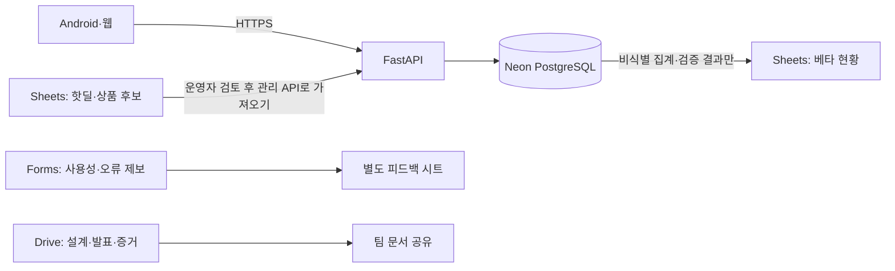

# Google Workspace 활용안

확인일: 2026-11-01. 사용자 요청: Google Workspace를 활용하는 방법도 검토. 이후 사용자는 **Neon 유지·전용 DB 접속정보의 Render 저장·무료 배포**를 승인했다. 따라서 DB 전환 없이 아래 운영 보조안을 검토한다. Google 파일·Forms·권한·자동화는 아직 생성하지 않았다.

## 추천 구성

**FastAPI + Neon을 앱의 기준 데이터로 유지하고, Google 도구는 콘텐츠 준비·베타 피드백·검증 현황에 활용 (추천).** 기존 Workspace 구독이 확인되지 않았으므로 신규 유료 구독을 전제하지 않는다. Sheets·Forms·Drive 일부는 개인 Google 계정으로도 쓸 수 있지만 조직 공유 드라이브·보안 정책·AppSheet 라이선스는 실제 계정 조건을 확인해야 한다.

Sheets에서 공구 인원·포인트 잔액·주문 상태를 직접 수정하지 않는다. 후보를 편집하는 곳과 앱에 게시하는 곳을 분리한다. 앱은 Sheets 장애와 관계없이 마지막으로 검증·반영된 데이터를 제공해야 한다.

## 우리 앱에 맞는 사용법

| 용도 | Google 도구 | 최소 항목과 처리 방식 |
|---|---|---|
| 육아 핫딜 후보 수집 | Sheets | 후보 ID, 분류, 출처 URL, 상품명, 배송 포함 가격, 마감, 확인일시, 사용권 확인, 검토상태. 승인한 건만 관리 API로 게시 |
| 베타 피드백 | Forms → Sheets | 앱 버전, Android 버전, 화면 ID01–57, 재현 단계, 기대/실제 결과, 심각도. 초대·복구코드·이메일·아이 정보는 질문하지 않음 |
| 화면 검증 현황 | Sheets | 화면 ID, 구현 상태, 정상/실패 시험, 증거 링크, 확인 커밋, 검토 일시. 체크 한 번으로 완료 처리하지 않음 |
| 데이터·AI 연구 결과 | Sheets·Drive | D1–D4 출처, 전처리 요약, 지표/분할 방법, 한계, 코드 링크. 고객 원본행·기업 원본 자료·실서비스 개인기록은 자동 복사하지 않음 |
| CTR·참여 흐름 분석 | Sheets 차트 | 허용된 이벤트의 일별 집계. 노출/상세클릭/시험참여를 분리하고 결제가 없으면 구매 CVR로 표시하지 않음 |
| 회의·발표·증거 | Docs·Slides·Drive | 확정 결정, 미결 사항, 코드·QA·원본 링크. Git의 구현·검증 문서를 기준으로 버전을 표시 |
| 내부 운영 화면 | AppSheet, 조건부 | 기존 라이선스로 팀원에게 제공 가능한 경우에만 후보/피드백 확인용. 소비자용 앱 대체는 추천하지 않음 |

제안한 연계는 아직 구현되지 않았다. 처음에는 개인정보 없는 CSV를 수동 가져오기/내보내기로 교환하고, 반복 업무가 확인되면 최소 권한 API나 Apps Script로 자동화한다. 새 Google 권한이나 제3자 데이터 전송은 필요한 범위만 확인한다. 메일 자동 발송은 사용자 요청에 따라 사용하지 않는다.

## Workspace를 앱 서버·DB로 대체하면 생기는 일

Sheets API는 단일 요청의 원자적 반영을 지원하고 Apps Script에는 LockService가 있다. 따라서 ‘동시 처리 자체가 불가능하다’고 단정하면 틀리다. 그러나 여러 요청에 걸친 읽기→재고검사→참여생성→포인트차감의 격리, 유일성·참조 관계, 부분 실패 복구를 현재 PostgreSQL 코드처럼 제공하지 않는다. 스크립트 잠금도 직접 시트 편집이나 다른 쓰기 경로까지 자동으로 막아 주지 않는다. 거래 경로·권한·재시도를 새로 설계해야 한다.

| 경로 | 가능한 범위 | 현재 프로젝트 판단 |
|---|---|---|
| **기존 앱 + Workspace 운영 보조 (추천)** | 현재 API/DB 보존, 후보/피드백/집계 관리 | 무료 베타 일정과 57개 화면 확장을 가장 적게 방해 |
| Apps Script + Sheets 전체 대체 | 소규모 내부 도구, 단순 목록·설문·예약 시제품 | 거래·권한·삭제·재시도를 재작성. 현재 Python/LightGBM 실행환경도 대체하지 못함 |
| AppSheet로 앱 재작성 | 조건에 맞는 내부 업무 앱 | 외부 이용자 라이선스·배포조건과 57개 맞춤 UX를 재검토해야 함 |
| Firebase Spark + Firestore | Google의 별도 앱 DB·일부 무료 서비스 | Workspace와 별도. SQLAlchemy 저장 계층 재작성 및 거래·권한 회귀검증 필요 |

## 공식 문서에서 확인한 무료 조건

- **Sheets API:** 기본 읽기/쓰기 각각 프로젝트당 분당300회, 사용자·프로젝트당60회. 한 서비스 계정으로 요청하면 사용자 쿼터도 공유한다. 문서는 표준 사용에 추가 비용이 없다고 설명하면서, 2026년 후반 쿼터 초과 요청 과금을 계획한다고 안내한다. 실제 API 연동 전 해당 프로젝트의 적용 정책을 다시 확인하고 결제 연결·쿼터 증액은 하지 않는다. ‘무제한 무료 DB’로 계산하지 않는다.
- **Apps Script:** 실행당6분, 사용자당 동시30회, 스크립트당1000회 제한이 안내돼 있다. 여러 서비스의 일별 쿼터도 함께 적용된다. 소유자로 실행하는 공개 웹앱은 요청이 소유자의 권한으로 실행되므로 외부 요청 검증이 중요하다. 공유 시트를 공개 편집 가능하게 만들어 인증을 대신하지 않는다.
- **AppSheet:** 무료 프로토타입 시험은 제작자 포함10명 이하. 일반 배포·외부 이용자에는 라이선스 조건이 따르고, Workspace에 Core가 포함돼도 모든 외부 고객이 자동 포함되는 것은 아니다. 신규 구독·User Pass를 구매하지 않는다.
- **Firestore Spark:** 결제정보 없이 시작 가능하며 Standard 무료 범위는1GiB 저장, 일5만 읽기·2만 쓰기·2만 삭제, 월10GiB 외부전송, 프로젝트당 무료 DB1개. TTL 삭제·PITR·관리형 백업/복원 등에는 결제 활성화가 필요하다. Spark에서 Cloud Functions·Cloud Run을 사용해 현재 Python 서버를 대체할 수는 없다. Cloud Billing을 연결하면 Blaze로 전환되므로 하지 않는다.

무료 한도 수치는 2026-11-01 확인값이며 계정·제품 변경에 따라 다시 확인해야 한다. 조직 구독 요금과 Google Cloud 사용 요금은 별개다. 기존 Google Cloud 결제 계정이 있다는 이유로 연결하지 않는다.

## 개인정보·운영 기준

- Google 쪽에는 계정 비밀번호·세션·초대/복구코드·DB 접속정보·배송지·판매자 증빙을 넣지 않는다.
- 피드백은 계정과 연결하지 않는 것을 기본으로 하고, 자유 입력에 개인정보를 쓰지 않도록 안내한다. 첨부 업로드는 필요성을 확인한 뒤 별도 접근권한·보관 기준을 갖춘다.
- 팀 문서는 지정된 팀원만 접근하도록 설정한다. 시트의 숨김 탭·보호 범위는 개인정보 접근 분리를 대체하지 못한다. 공개용 자료는 별도 파일로 만든다.
- 자동 동기화가 필요해지면 공유 대상 파일만 접근하고, 동기화 방향·스키마·버전·실패 이력을 둔다. 악성 수식/링크와 잘못된 가격·마감·출처를 검증한 뒤 서버 API로 가져온다.
- 일별 CTR은 상세 클릭/유효 노출로, 시험 참여율은 완료한 시험 참여/정의한 모집 상세 방문으로 계산한다. 분모·중복·봇·내부시험 제외 규칙을 저장한다. 실제 이벤트 수집 전에는 수치를 만들지 않는다.

## 출처

1. [Google Workspace 요금제](https://workspace.google.com/pricing)
2. [Sheets API 사용량·비용](https://developers.google.com/workspace/sheets/api/limits)
3. [Apps Script 쿼터](https://developers.google.com/apps-script/guides/services/quotas)
4. [Apps Script LockService](https://developers.google.com/apps-script/reference/lock/lock-service)
5. [Apps Script 웹앱 권한](https://developers.google.com/apps-script/guides/web)
6. [AppSheet 무료 사용 조건](https://support.google.com/appsheet/answer/10104499?hl=en), [라이선스 FAQ](https://support.google.com/appsheet/answer/10106235?hl=en)
7. [Firebase Spark/Blaze](https://firebase.google.com/docs/projects/billing/firebase-pricing-plans), [Firestore 무료 한도](https://firebase.google.com/docs/firestore/quotas)
