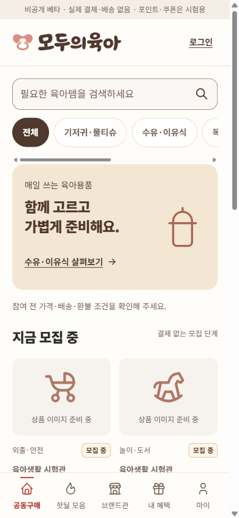

# 로그인보다 탐색이 먼저인 진입 UX

2026-11-01. 요청: 앱을 처음 열면 공구·핫딜을 바로 볼 수 있어야 한다. 브랜드와 기존 화면설계는 유지한다.

## 결함과 수정

기존 `/`는 `moduyuga.intro` 저장값이 없으면 `/welcome`으로 이동했다. 소개 화면에 가입·로그인이 배치되어 새 설치에서 탐색이 뒤로 밀렸다. 기존 상세 URL 중심 검사는 이 분기를 놓쳤다.

- 첫 실행·재방문 모두 `/`에서 검색, 카테고리, 공구 목록, 하단 메뉴를 표시한다.
- 로그인은 참여·저장 등 계정이 필요한 행동에서 요청한다.
- 로그인 화면에 `로그인 없이 둘러보기`를 추가했다. 공개 상세에서 왔다면 원래 상세로, 계정 전용 화면에서 왔다면 홈으로 이동한다.
- 로그인 성공 목적지와 회원가입의 원래 목적지는 보존한다. 선택 수량을 유지하며 로그인만으로 참여를 자동 실행하지 않는다.
- `/welcome`은 직접 접근할 수 있는 자발적 소개 페이지로 남긴다.

## 실제 확인한 참고 서비스와 반영 범위

| 참고 | 확인한 웹 UI | 모두의 육아 적용 |
|---|---|---|
| [쿠팡](https://www.coupang.com/) | 검색·카테고리·상품 발견 영역, 로그인·판매자 진입 분리. 검색 커넥터로 홈 내용 확인 | 탐색을 홈의 기본 행동으로 유지. 로그인은 보조 진입 |
| [11번가](https://www.11st.co.kr/) | 렌더된 웹에서 로그인 링크와 함께 통합검색·카테고리·베스트·쇼킹딜·가격·배송 정보를 확인 | 검색·카테고리 우선. 가격·배송·모집 조건을 상세 진입 전에 제공 |
| [네이버쇼핑](https://shopping.naver.com/ns/home) | 검색·카테고리·딜 탐색 탭. 확인 브라우저는 로그인 상태였으므로 비회원 접근 증거로 사용하지 않음 | 목적별 탐색 메뉴와 브랜드관을 유지 |
| [당근](https://www.daangn.com/kr/) | 공개 웹 탐색·검색·카테고리·커뮤니티 정보와 별도 채팅 진입 | 공개 정보 열람과 계정이 필요한 행동을 분리 |

네이티브 앱의 모든 가입·결제 흐름을 검증한 비교가 아니다. 각 서비스의 브랜드 디자인·상품 이미지·광고 문구는 복제하지 않았다. 홈 화면에 가짜 최저가·구매 인원·후기를 만들지 않는다.

## 검증 기록

- 실제 앱 시작 트리를 검사하는 회귀 테스트: 최초 수정 전 17개 중 8개 실패, 수정 후 17개 통과. 당시 전체 suite 75개 통과.
- 별도 코드 검토에서 보호 경로로 돌아가는 게스트 링크 결함을 발견했다. 공개 라우트 매칭으로 보완한 뒤 해당 회귀 37개 통과. 검토 재판정 승인.
- 브라우저 새 로컬 origin: intro 값 없음, 세션 없음. 비회원 홈에 실제 시험 목록 6개와 비밀번호 입력란 0개 확인.
- 390px 화면에서 검색어 `기저귀`로 시험 상품 1개 표시. 상세의 수량 3 → 참여 → 로그인 → 둘러보기 → 수량 3 유지.
- `/login?returnTo=/my/saved`의 둘러보기 링크가 `/`로 연결되고 검색 가능한 홈으로 실제 복귀하는 것을 확인.
- 로컬 브라우저 검사는 개발 서버의 동일 출처 프록시로 무료 공개 API를 읽었다. 운영 CORS 설정은 변경하지 않았다. 로컬 프록시는 배포물이 아니다.
- 최종 수정 커밋 `b0e3a8a`의 GitHub CI에서 프런트 95개·백엔드 40개 통과, TypeScript/Vite 빌드 성공. 백엔드 테스트 도구 호환성 경고 1개는 기존 상태다.
- Render Free에 같은 커밋 배포 완료: `dep-dbjks5ec6qcc73bqvkmg`, `Deploy succeeded | Live` 확인. 실제 HTTPS origin에서도 intro 없음/세션 없음으로 새 진입을 재현하여 목록 6개·비밀번호 입력 0개·390px 가로 넘침 없음과 로그인에서 홈 복귀를 확인했다. 검사 후 기존 소개 저장값과 화면 크기 설정을 복원했다.

증거는 `artifacts/beta/guest-first-*`에 보관한다. Android 패키지 서명·번들 검증과 실제 휴대폰 실행은 서로 다른 검증 단계로 기록한다.

## Android 수정 패키지

0.2.1/versionCode3 APK·AAB를 기존 업로드 키로 빌드했다. Gradle 133개 작업이 성공했고 서명·정식명·HTTPS API·CSP·권한 등 오프라인30검사를 통과했다. APK와 AAB에 들어간 웹 파일 전체가 이번 `frontend/dist`와 SHA-256 기준으로 일치한다. package `kr.moduyuga.app`, minSDK24, targetSDK36이다.

| 파일 | SHA-256 |
|---|---|
| `moduyuga-beta.aab` | `35f731f15c20961e8451a4112d10f4fe0c71b2af8a451b6a25e471375461be5b` |
| `moduyuga-beta.apk` | `8e51cf6fa0a1f757bfce08bd68e68ef228f1013c922994b90b8fe3d049285d79` |

기존0.2.0 패키지와 검증 JSON은 `artifacts/android/releases/2-0.2.0`에 보존했다. 최신 파일은 `artifacts/android/release`에 있다. 에뮬레이터를 시작하거나 Android Studio를 설치하지 않았다. 이 PC의 새 Gradle 캐시는 E:에만 작성했다.

빌드 로그에는 기존 도구 체인의 flatDir·SDK XML 버전·Gradle deprecation 및 생성 manifest 중복 replace 관련 경고가 있다. 빌드/필수 release lint 성공과 경고가 없는 상태는 구분한다. Gradle9 전환이나 SDK/플러그인 갱신은 이번 UX 수정 범위에 포함하지 않았다.

Play에 versionCode3 업로드 후 2026-11-01 23:58 KST, **0.2.1 · 비회원 첫 화면 개선 / 활성 / 내부 테스터에게 제공됨**을 확인했다. 기존 승인 계정만 대상이며 팀원을 추가하지 않았다. 유일한 콘솔 경고는 난독화 가독화 파일 없음으로, 현재 minifyEnabled=false인 빌드다. 차단 오류는 없었다. `artifacts/beta/play-internal-0.2.1-active.jpg`에 증거를 보관한다. 이 내부 배포는 프로덕션 공개 출시나 새 버전의 실기기 실행 관찰을 뜻하지 않는다.
