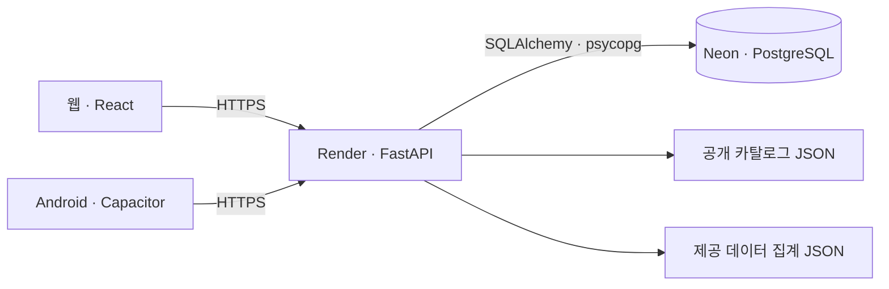

# 모두의 육아 회의 빠른 답변

2026년 11월 4일 · 코드·배포 기록과 오늘 공개 접속 기준

## 11/4 추가 구현과 중간평가 동선

- **내 조건으로 찾기**: 홈 → 용도·분야·비교 기준·예산 선택 → 실제 공식 목록. 비회원 미저장, 로그인하면 본인 조건 저장·삭제.
- **함께 살펴볼 육아템**: 상세에서 실제 공동 저장 5계정 이상만 근거로 표시. 없으면 같은 분야 안내 또는 빈 상태.
- **비교 CTA**: 사용자가 고른 가격·구성·관리 기준에 맞춰 계산기/공식 출처 연결.
- **GEO**: 품목별 정적 비교 HTML + Article JSON-LD + 출처. 현재 참고 목록에 판매 가격·KC를 만들지 않음.
- **DB**: records의 release_advisor에 본인 조건 JSON 저장. 기존 API·DB 공유, 새 테이블/스키마 변경 없음.
- **협업**: P0 29 / P1 31 / P2 68. 시트에 최용우(API/GEO), 최유정(UI), 이승현(데이터), T19~T24 담당 체크박스 배정.

자세한 검증·배포 상태: [DATA-AND-SCOPE](../../build/release-20261104/DATA-AND-SCOPE.md). 선택형 기능이며 자유대화 LLM·실시간 LightGBM 구매확률은 완료 범위가 아니다.

## 30초 설명

제공 데이터로 소비자 차이와 거래 패턴을 분석했고, 관심 설정·개인화 목록·공동 저장 분석에 반영했습니다. 앱과 웹은 같은 API와 PostgreSQL DB를 사용하며, 실제 반응은 동의 기반 노출·클릭·저장으로 측정합니다.

## 한눈에 답하기

| 질문 | 바로 답할 내용 |
|---|---|
| 데이터 어떻게 썼어? | 소비자 차이 → 관심 설정 / 거래 패턴 → 함께 저장한 품목 분석 / 종료 세션 모델 → 연구 결과 보존 |
| DB 뭐 써? | Neon의 PostgreSQL. 회원·인증·서비스 활동을 저장하고 FastAPI 서버만 DB에 접속 |
| 앱과 웹 연동돼? | 같은 계정·API·DB 공유. 저장·설정은 다시 조회하면 반영되고 로그인 세션은 각각 유지 |
| AI가 추천해? | 현재 홈은 관심 분야·저장 이력에 따른 규칙 방식. 선택형 조건 찾기는 추가 구현했고 자유대화 추천은 추가 범위 |
| 로그인·개인정보는? | 이메일 가입은 이메일·해시된 비밀번호 등 저장. 카카오는 제공자 회원번호를 내부 계정과 연결 |
| 지금 어디까지 됐어? | 공개 웹·관심 설정·저장 분석·측정 구현. Google 로그인, 새 Android 배포·실기기 확인, 실거래는 남음 |
| 성과 입증했어? | 과거 데이터 분석·기능 검증은 있음. 실제 CTR·구매·매출 향상은 아직 미입증 |

## 앱·웹·DB 연결

**DB에 저장:** 회원·로그인·저장·관심 설정·수요 글·댓글·신고·동의·측정 정보.

**파일에서 읽기:** 현재 공개 육아템 목록과 제공 데이터 분석 집계.

| 테이블 | 역할 | 주요 내용 |
|---|---|---|
| users | 회원 | 회원 ID, 이메일, 비밀번호 해시, 닉네임, 권한·탈퇴 상태 |
| tokens | 인증 | 세션·복구용 토큰의 해시, 회원 ID, 종류, 만료 |
| rate_buckets | 요청 제한 | 가명 처리한 제한 키, 횟수, 만료 |
| records | 서비스 기록 | 관심 설정·저장·수요 글·댓글·신고·동의·노출/클릭 정보·소셜 연결 등을 종류별 관리 |

## 데이터 적용

| 제공 자료 | 확인한 내용 | 사용한 곳 | 해석 범위 |
|---|---|---|---|
| D1 소비자 1,000명 | 할인 민감도 35.0% / 31.9% / 33.1% | 마이페이지 관심 분야·비교 기준 선택 | 육아용품 표본은 41명. 국내 육아 고객의 대표 통계로 일반화하지 않음 |
| D2 거래 541,909행 | D3 두 번째 시트와 전체 중복 | 분석에서 중복 합산 제외 | 별도 추가 거래량으로 세지 않음 |
| D3 거래 1,067,371행 | 함께 구매된 품목의 관계 분석 | 운영자에게 5계정 이상 공동 저장 조합 표시 | 과거 해외 상품의 규칙을 현재 육아 상품에 직접 적용한 것은 아님 |
| D4 종료 세션 12,330개 | 구매 여부 분류 모델 비교 | 모델은 연구용 보존; 서비스는 비교 안내 제공 | 실시간 구매 점수로 쓰지 않음 |

## 오늘 접속과 남은 범위

11/4 10:58 KST 확인: 웹 200 · API 200. API 첫 응답 42.75초 → 후속 0.33초. 활성 소셜은 카카오, 실제 결제는 비활성.

남은 작업: Google 활성화 · Android 새 버전 업로드/실기기 확인 · 대화형 추천 · 실제 주문/결제/배송/환불/정산 · 응답 지연 및 DB 복원 검증

첫 응답 지연의 원인을 이번 점검만으로 확정하지 않았다. 운영 DB의 실제 회원 원문을 조회한 점검은 아니다.

## 주어진 데이터가 앱에서 뭘 바꿨나요?

**소비자마다 다른 비교 기준을 선택하게 하고, 함께 저장한 육아템을 운영자가 분석하도록 만들었습니다.**

D1은 할인 민감도의 차이를 확인해 관심 분야 최대 3개와 가격·수량, 구성·규격, 사용·관리 기준을 직접 고르는 설계에 참고했습니다. 이 선택지가 통계적으로 최적이라고 증명한 것은 아닙니다.

D2는 D3와 겹치는 541,909행을 중복 합산에서 제외했습니다. D3 동시구매의 동시 출현 집계 방법은 현재 회원의 공동 저장 분석에 활용했습니다.

D4는 완료된 세션의 구매 여부를 분류하는 연구입니다. 현재 방문자의 실시간 구매 점수로 연결하지 않았습니다.

시연·설명 위치: 마이페이지 → 관심 육아템 설정 → 홈의 내 관심 육아템 / 운영자 → 육아템 관심 분석

근거: `docs/reports/data-use-20261103/REPORT.md`, `backend/app/discovery_evidence.json`, `backend/app/discovery.py`, `backend/app/release.py`

## 원본 데이터는 전부 운영 DB에 넣었나요?

**원본은 분석용으로 보존하고, 서비스에는 검토한 집계·근거와 필요한 분석 방법을 반영했습니다.**

제공 데이터의 해외 소비자·고객 ID는 우리 회원 ID와 연결되지 않습니다. 서로 다른 자료의 사람·세션·상품을 같은 대상으로 가정해 합치지 않았습니다.

현재 공개 육아템 목록은 release_catalog.json, 제공 자료 집계는 discovery_evidence.json에서 읽습니다. 회원의 저장·관심·글·동의·측정 기록은 운영 DB에 쌓입니다.

따라서 공개 카탈로그 갱신은 현재 검토된 파일의 수정과 배포가 필요한 구조입니다. 실시간 판매자 상품 DB·재고 자동 동기화가 완료된 상태는 아닙니다.

시연·설명 위치: 공개 카탈로그와 회원 활동 저장소의 역할을 나눠 설명

근거: `backend/app/release.py:77`, `backend/app/release_catalog.json`, `backend/app/discovery_evidence.json`, `ai-pipeline/pipeline.py`

## DB는 뭘 쓰고 어디에 있나요?

**Neon에서 운영하는 PostgreSQL을 사용하고, Render의 FastAPI 서버를 통해 읽고 씁니다.**

웹은 React·TypeScript, Android는 같은 웹 코드를 Capacitor로 패키징합니다. 두 클라이언트는 HTTPS로 같은 API를 호출합니다.

서버는 SQLAlchemy와 psycopg로 PostgreSQL에 연결합니다. DB 접속정보는 서버 비밀 환경변수에 있고 앱·웹 번들에 넣지 않습니다.

로컬 시험에서는 SQLite를 사용할 수 있지만, 공개 배포 모드는 전용 PostgreSQL 연결을 요구합니다. MongoDB로 전환한 상태가 아닙니다.

시연·설명 위치: 웹·Android → HTTPS API → SQLAlchemy → Neon PostgreSQL

근거: `backend/app/db.py`, `backend/app/config.py`, `render.yaml`, `docs/build/beta-20261101/DATABASE-CHOICE.md`

## 테이블 구조는 어떻게 되어 있나요?

**현재 코드에 정의된 테이블은 users, tokens, rate_buckets, records의 4개입니다.**

users는 회원, tokens는 인증·복구 토큰 해시, rate_buckets는 요청 제한을 관리합니다. tokens.user_id와 records.owner_id는 users.id를 참조합니다.

records는 kind로 기능 종류를, owner_id로 소유 계정을, parent_id로 대상 식별자를, data JSON으로 기능별 값을 보관합니다. 예: release_preference, release_save, release_demand, growth_consent, growth_exposure, oauth_identity.

records의 parent_id는 범용 문자열이며 외래키가 아닙니다. 대상 존재와 소유권 확인은 해당 API에서 합니다. kind와 unique_key에는 DB 유일성 제약이 있습니다.

현재 범용 구조를 주문·결제·정산의 완성된 정규화 스키마라고 설명하지 않습니다. 실제 거래 확장 전 상품·옵션·재고·주문·결제·원장 모델과 버전별 마이그레이션이 필요합니다.

시연·설명 위치: DB 구조 질문에는 먼저 ‘4개 테이블 + 종류별 서비스 기록’이라고 답변

근거: `backend/app/db.py:28`, `backend/app/db.py:56`, `backend/app/release.py:194`

## 웹에서 저장하면 앱에서도 같은 내용이 보이나요?

**같은 회원 계정이면 같은 DB의 자료를 읽기 때문에 다시 조회할 때 공유됩니다.**

웹과 앱의 로그인 세션은 각각입니다. 같은 내부 회원 ID로 로그인하면 관심 설정과 저장 목록을 함께 사용합니다.

웹에서 저장 → 서버가 회원 ID와 품목 ID로 저장 → 앱이 저장 목록 재조회 순서입니다. 실시간 푸시나 오프라인 변경 자동 병합을 구현했다는 뜻은 아닙니다.

한 계정의 반복 저장은 고유 키로 중복 생성하지 않습니다. 다른 계정의 개인 기록을 읽거나 수정하는 동작은 권한 검사로 제한합니다.

새 화면이 포함된 Android 0.5.0(code 7)은 파일 생성·서명 검증까지 했고 Play 업로드와 실기기 소셜 복귀 확인은 미완료입니다. 기존 설치본에는 자동 반영되지 않습니다.

시연·설명 위치: 같은 계정으로 웹에서 저장한 뒤 앱에서 목록 다시 조회

근거: `docs/build/release-20261102/MYPAGE-AND-WEB.md:63`, `backend/app/release.py`, `docs/build/release-20261102/AUTH-AND-MEASUREMENT.md:82`

## AI 추천 모델이 실제 앱을 움직이나요?

**현재 홈은 명시적 관심 분야와 저장 이력을 사용하는 규칙 기반 개인화입니다.**

선택한 분야를 우선하고, 설정이 없으면 저장 분야를 참고합니다. 만료 항목을 제외하고 미저장 품목을 우선해 최대 3개와 표시 이유를 보여줍니다.

연구용 LightGBM은 검증 AP로 선택했습니다. 평가 AUROC 0.7448, AP 0.2937이며, 로지스틱 회귀의 평가 AP는 0.3054로 더 높았습니다.

과거 동시구매 실험의 Recall@5는 규칙 36.21%, 인기순 10.56%입니다. 남은 장바구니를 알고 숨긴 한 품목을 찾는 평가로, 우리 앱 구매율이 아닙니다.

새 설계서의 예산·선물 상황 대화, 조건 변경, 대화 기록 유지·삭제는 추가 구현 범위입니다.

시연·설명 위치: 발표에서는 ‘규칙 기반 개인화’와 ‘연구용 모델’을 정확히 구분

근거: `backend/app/discovery.py`, `ai-pipeline/artifacts/evaluation.json`, `docs/reports/data-use-20261103/DESIGN-REFERENCE.md`

## 우리가 개인정보를 받는 건가요?

**네. 이메일 가입 정보와 서비스 활동을 저장하며, 소셜 로그인도 내부 계정 연결 정보는 필요합니다.**

이메일 가입은 이메일·닉네임·비밀번호 해시 등을 저장합니다. 비밀번호 원문을 저장하지 않고 인증·복구 토큰도 해시 형태로 관리합니다.

현재 카카오 연결은 제공자 회원번호를 내부 계정에 연결합니다. 카카오 비밀번호를 받지 않고, 카카오 이메일·이름·사진 권한은 요청하지 않습니다. 기존 이메일 계정에 연결한 경우 기존 회원 정보는 유지됩니다.

노출·클릭 측정은 기본 미동의이며 동의한 일반 회원만 집계합니다. 운영자는 측정에서 제외하고 작은 비영(1~4명) 집계와 비율은 숨깁니다.

탈퇴는 계정 식별정보를 사용 불가 상태로 바꾸고 세션·관련 기록을 처리합니다. 모든 공급자 백업에서 즉시 삭제된다고 보장한 것은 아닙니다.

시연·설명 위치: 마이페이지 → 계정 관리·정책·측정 동의

근거: `backend/app/security.py`, `backend/app/social_auth.py`, `backend/app/growth.py`, `docs/build/release-20261102/DATA-SAFETY.md`

## 구글·카카오 로그인은 지금 되나요?

**현재 공개 API에서 활성으로 반환하는 제공자는 카카오입니다. Google 활성화는 미완료입니다.**

2026년 11월 4일 공개 제공자 조회에서도 kakao만 반환했습니다. 11월 2일 운영 기록에는 기존 운영자 계정의 카카오 연결·로그아웃 후 재로그인 성공이 있습니다.

Google 연결 코드는 있지만 지정 관리 계정의 프로젝트 한도 문제로 운영 활성화를 끝내지 못했습니다. 네이버 운영 인증 완료 근거도 없습니다.

일반 신규 회원의 실제 제공자 동의부터 가입까지 운영 종단 확인과 Android 실기기 소셜 복귀는 별도 확인이 필요합니다.

시연·설명 위치: 로그인 화면 / 공개 API의 활성 제공자 목록

근거: `docs/build/release-20261102/AUTH-AND-MEASUREMENT.md:73`, `artifacts/meeting-20261104/public-read-check.json`

## CTR·CTA·검색 노출은 어떻게 측정하나요?

**동의한 회원의 실제 노출과 클릭, 서버가 확인한 저장·관심 완료를 연결합니다.**

카드의 50% 이상이 1초 연속 보인 경우를 노출로 보고합니다. 계정·항목·위치·플랫폼·한국 날짜로 중복을 관리합니다.

최근 30일의 위치·플랫폼별 CTR은 고유 클릭 계정 ÷ 고유 노출 계정입니다. 신규 저장·관심 완료는 30분 이내 마지막 측정 클릭에 귀속합니다.

95% Wilson 구간을 표시하고 최소 노출 200계정, 클릭·미클릭 각각 20계정 이전에는 효과 판단을 보류합니다. 이후에도 관찰 지표이며 A/B 실험의 인과 효과가 아닙니다.

공개 가이드에 비교 기준·출처·구조화 데이터를 제공했습니다. 검색 CTR과 AI 답변 인용은 별도 측정해야 하며 AEO·GEO 기반 노출 향상은 아직 확인하지 않았습니다.

시연·설명 위치: 운영자 → 육아템 관심 분석 → 노출·클릭·저장·관심 / 공개 가이드

근거: `backend/app/growth.py`, `frontend/src/measurement.tsx`, `scripts/export-public-guides.py`

## 서버·DB는 안정적인가요? 백업은요?

**저장 구조와 연결은 동작하지만 긴 초기 응답 지연과 복구 운영은 남은 과제입니다.**

오늘 읽기 점검에서 웹 200 응답은 0.55초, API 첫 응답은 42.75초였고 후속 요청은 0.33초였습니다. 그 한 번의 지연 원인을 절전으로 확정하지는 않습니다.

무료 호스트의 유휴 기동 지연 가능성이 있습니다. 90초 요청 제한과 지연 안내를 넣었으며 변경 요청은 자동 재전송하지 않습니다. 상시 즉시 응답·무중단을 보장하지 않습니다.

DB는 API 서버와 별도로 Neon에 있어 서버 재시작만으로 회원 데이터가 사라지는 구조는 아닙니다. 별도 DB가 있다는 사실이 백업·복원 검증을 대신하지 않습니다.

초기 Neon 설정 기록에는 복구 이력이 있었지만 현재 창·정책 재확인과 별도 백업·복원 실증은 미완료입니다. 현행 초기화는 create_all이며 버전별 스키마 변경 절차도 정리해야 합니다.

시연·설명 위치: 회의에서는 응답 지연·백업·복구 기준을 운영 과제로 제시

근거: `artifacts/meeting-20261104/public-read-check.json`, `backend/app/db.py`, `docs/build/beta-20261101/DATABASE-CHOICE.md`, `docs/build/release-20261102/DATA-SAFETY.md`

## 완료된 것과 남은 것은 무엇인가요?

**공개 탐색·관심 설정·저장·분석·측정 기반은 있고, 새 설계 전체와 실거래까지 완료한 것은 아닙니다.**

구현·배포 기록: 공개 웹, 비교 가이드·계산기, 회원 관심 설정·저장, 수요 글·댓글, 운영자 공동 저장 분석, 동의 기반 측정, 기존 계정 카카오 재로그인.

검증 기록: 서버 132개·프런트 159개·PostgreSQL 71개 검사. 이는 전체 기능 검사 수이며 데이터 모델 정확도나 운영 효과를 뜻하지 않습니다.

남음: Google 활성화, Android 0.5.0의 Play 업로드·실기기 확인, 대화형 추천과 대화 보관·삭제, 실제 주문·결제·배송·환불·정산, 새 설계 수용조건별 검증.

제공 자료의 128개 요구사항과 346개 화면 상태는 목표 명세의 크기입니다. 완료율이나 구현된 기능 수로 환산하지 않았습니다.

시연·설명 위치: 실제 웹을 시연하고, 설계 화면은 설계라고 표시

근거: `docs/reports/data-use-20261103/DESIGN-REFERENCE.md`, `docs/build/release-20261102/AUTH-AND-MEASUREMENT.md`, `docs/build/release-20261102/SERVICE-DATA.md`

## 오늘 회의에서 뭘 정하면 되나요?

**발표 범위, 다음 구현 순서, 실제 운영 검증의 담당자를 정하면 됩니다.**

발표는 검증된 데이터 분석 → 현재 적용 화면 → 측정 방식 순서로 진행하는 것을 추천합니다. 미구현 설계는 다음 구현 범위로 설명합니다.

다음 구현은 새 요구사항 ID와 현재 코드의 차이를 기준으로 우선순위·담당자·완료 조건을 정합니다. 대화형 추천과 실제 거래 연동은 별도 작업 단위로 잡아야 합니다.

Google 관리 계정의 한도 해결, Android 실기기 확인, 서버 응답 지연 대책, DB 복원 확인의 담당자를 정합니다. 비용·외부 권한·실결제 승인 없이 이를 완료됐다고 처리하지 않습니다.

시연·설명 위치: 시연: 관심 설정 → 홈 목록 → 운영자 관심 분석 → 측정 화면

근거: `docs/reports/data-use-20261103/PRESENTATION-SCRIPT.md`, `docs/reports/data-use-20261103/DESIGN-REFERENCE.md`

## 회의에서 정할 사항

1. 현재 구현·검증된 분석과 화면을 발표 범위로 사용 (추천).
2. 새 128개 요구사항에 대한 다음 구현 순서·담당자·완료 조건.
3. Google 인증·Android 실기기·서버 응답·DB 복원 확인의 담당자.

공유 링크: [정식 웹](https://moduyuga.onrender.com/) · [관심 설정](https://moduyuga.onrender.com/my/preferences) · [운영자 분석](https://moduyuga.onrender.com/admin/insights) · [공개 가이드](https://moduyuga.onrender.com/guides.html)

## 팀 협업 시트

[Team_Wifi_FP — 담당 체크와 업무 수정](https://docs.google.com/spreadsheets/d/15TfV_XCtgJCjMyW-cLnYF8oTbvf9ebcfqCzm69SxIrY/edit#gid=612340017)

팀원별 할 일에서 이승현·최유정·최용우 체크박스로 담당을 정합니다. 여러 명을 체크하면 공동 담당입니다. 업무·상태·기한·다음 행동은 같은 표에서 직접 수정하고, 상단의 팀원별 요약과 대시보드·업무 현황은 자동 계산됩니다. 기존 10월 30일 업무와 회의 원문은 보존했습니다.

132/159/71 검증 수치는 [로그인·프로필 배포 기록](../../build/release-20261104/LOGIN-AND-PROFILE.md) 기준입니다.
